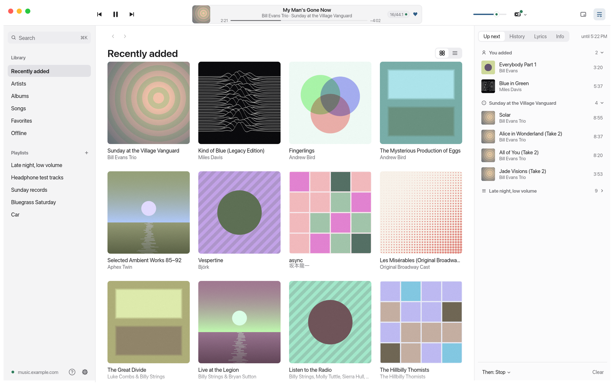

# Ond

Ond is a native music player for [Navidrome](https://www.navidrome.org) and other OpenSubsonic servers, written in Rust with [egui](https://www.egui.rs). It runs on macOS, Linux and Windows. macOS is where it started and has the most complete audio path; the Linux and Windows builds are new.

I wanted a client that treats playback quality as the main feature and stays out of the way otherwise. Ond plays your original files, tells you exactly what happens to the signal on its way to the speakers, and keeps the interface quiet unless you ask for more.

Note: Ond was built using LLMs. See [AI Disclosure](#ai-disclosure)

<picture>
  <source media="(prefers-color-scheme: dark)" srcset="docs/images/library-dark.png">
  
</picture>

## What it does

- **Bit-perfect playback on macOS and Linux.** Ond takes exclusive access to the device and switches its sample rate to match each file. On Linux it asks PipeWire (or PulseAudio, or JACK) to let go of the sound card first, and gives it back a few seconds after playback stops. A green dot shows only when every condition holds, and Ond says why when it can't. Normal mode has ReplayGain, resampling and dither, and plays through PipeWire (or ALSA) on Linux. Windows plays through WASAPI.
- **Gapless**, and seeking into parts of a track that haven't downloaded yet.
- **A local copy of your library.** Browsing and search (⌘K) don't wait on the server, and offline downloads keep playing when it's unreachable.
- **Library analysis.** Loudness, dynamic range, and a check for files that claim to be hi-res but were upsampled or made from lossy sources.
- **Three window modes.** Full is the whole library, Player has large artwork with the queue and lyrics, and Mini is a small square that stays on top.
- **Keyboard first.** Shortcuts for nearly everything; ⌘/ (Ctrl+/ on Linux and Windows) lists them. Media keys and the system's now-playing controls work on all three platforms.

The covers in the screenshot are made up.

## Install

Downloads are on the [Releases](../../releases) page.

### macOS

Open the `.dmg` and drag Ond to Applications.

The app isn't signed with an Apple Developer ID yet, so macOS blocks the first launch. Right-click Ond in Applications and choose Open, or run:

```sh
xattr -dr com.apple.quarantine /Applications/Ond.app
```

Ond needs macOS 11 (Big Sur) or later.

### Linux

Unpack the `.tar.gz` and run its install script. It puts `ond`, the menu entry and the icons under `~/.local`:

```sh
tar xf Ond-*-linux-*.tar.gz
cd Ond-*/
./install.sh                 # or: sudo ./install.sh /usr/local
./install.sh --uninstall     # to remove it again
```

Ond needs PipeWire's library (`libpipewire-0.3`), which every current desktop distribution ships, and glibc 2.39 or newer (Ubuntu 24.04, Fedora 40, Debian 13). The password goes in the Secret Service keyring (GNOME Keyring or KWallet).

### Nix and NixOS

The repository is a flake. `nix run github:Solidsilver/ond` tries it, and `nix profile install github:Solidsilver/ond` installs it. In a NixOS config, use `ond.packages.${system}.default` or apply `ond.overlays.default` and use `pkgs.ond`. Add a tag to pin a release, like `github:Solidsilver/ond/v0.3.0`.

With Home Manager, the flake's module installs Ond and can set any of its settings. Settings set there are locked in the app, and the rest stay editable. It works on macOS too, for the app bundle. [docs/home-manager.md](docs/home-manager.md) has the setup and every setting.

### Windows

Unzip and run `Ond.exe`. There's no installer yet. Windows SmartScreen may warn on first launch because the app isn't signed; choose More info, then Run anyway.

### Servers

Ond works with Navidrome and other OpenSubsonic servers. Credits need Navidrome 0.55 or newer.

## Build from source

With Nix, `nix develop` gives you a shell with Rust, rust-analyzer and every system library the build needs, on Linux and macOS. With direnv, `direnv allow` once and the shell loads whenever you `cd` in. `nix build` builds the Linux package.

Without Nix, you need a recent stable Rust toolchain (`rustup`), plus:

- macOS: the Xcode command line tools.
- Linux: ALSA and PipeWire headers, clang and pkg-config. On Debian and Ubuntu that's `sudo apt install libasound2-dev libpipewire-0.3-dev clang pkg-config`; on Fedora, `sudo dnf install alsa-lib-devel pipewire-devel clang pkgconf`.
- Windows: Visual Studio's C++ build tools.

```sh
cargo run -p ond-player --release
```

Use `--release` for listening. Debug builds are slow enough to cause dropouts. The package is called `ond-player`; the binary it builds is `Ond`, so the app shows as Ond in the macOS menu bar and Dock even when you run it with cargo. To see the window-mode timings in the log, run with `RUST_LOG=ond::window=debug`.

To package a release build in `target/bundle/`:

```sh
scripts/bundle-macos.sh              # Ond.app, .zip and .dmg for this Mac's architecture
scripts/bundle-macos.sh --universal  # the same for Apple silicon and Intel
scripts/bundle-linux.sh              # .tar.gz with the install script
pwsh scripts/bundle-windows.ps1      # .zip with Ond.exe
```

## Where things are stored

| What | macOS | Linux | Windows |
|---|---|---|---|
| Password | Keychain | Secret Service keyring | Credential Manager |
| Settings | `~/Library/Application Support/dev.solidsilver.ond/` | `~/.config/ond/` | `%APPDATA%\solidsilver\ond\config\` |
| Library, analysis and offline downloads | `~/Library/Application Support/dev.solidsilver.ond/` | `~/.local/share/ond/` | `%LOCALAPPDATA%\solidsilver\ond\data\` |
| Stream and artwork caches | `~/Library/Caches/dev.solidsilver.ond/` | `~/.cache/ond/` | `%LOCALAPPDATA%\solidsilver\ond\cache\` |
| Logs | `~/Library/Logs/Ond/` | `~/.local/state/ond/logs/` | `%LOCALAPPDATA%\solidsilver\ond\data\logs\` |

You can move the offline downloads folder in Settings.

The library database is a copy of what's on your server. If it ever breaks, Ond moves it aside and syncs again.

## Development

The workspace has seven crates:

| Crate | Job |
|---|---|
| `app` | The `ond-player` package, which builds the `Ond` binary: UI, queue, sync, settings, and each system's integration |
| `subsonic` | OpenSubsonic API client |
| `library` | Local library mirror in redb, with hand-written indexes and migrations |
| `streamcache` | Download cache that playback can read and seek while it fills |
| `offline` | Pinned downloads |
| `audio` | Decoding, the playback engine, resampling, dither, CoreAudio, ALSA and cpal (PipeWire, ALSA, WASAPI) output |
| `analysis` | Loudness, dynamic range and fake hi-res detection |

None of the crates are published to crates.io.

Before sending changes:

```sh
cargo clippy --workspace --all-targets -- -D warnings
cargo test --workspace
```

The UI tests can render every screen to PNG without a server, which is how most of the visual work gets checked:

```sh
cargo test -p ond-player --release snapshots -- --ignored --nocapture
# images land in target/snapshots/
```

The screenshot in this README comes from the `readme_snapshots` test, resized to 1920 pixels wide into `docs/images/`.

Some things need real hardware or a real server. [TESTING.md](TESTING.md) lists them.

`main` holds releases and `dev` is where work happens. Pushing a `v*` tag builds the app and publishes a GitHub release.

## AI Disclosure

I built Ond with Claude Opus 5.5 in Claude Code. I came up with the initial idea, did research on the UI design, made all of the design decisions, and tested on my own library and hardware. Claude wrote most of the code. 

## License

Dual-licensed under [MIT](LICENSE-MIT) or [Apache 2.0](LICENSE-APACHE), at your option.
